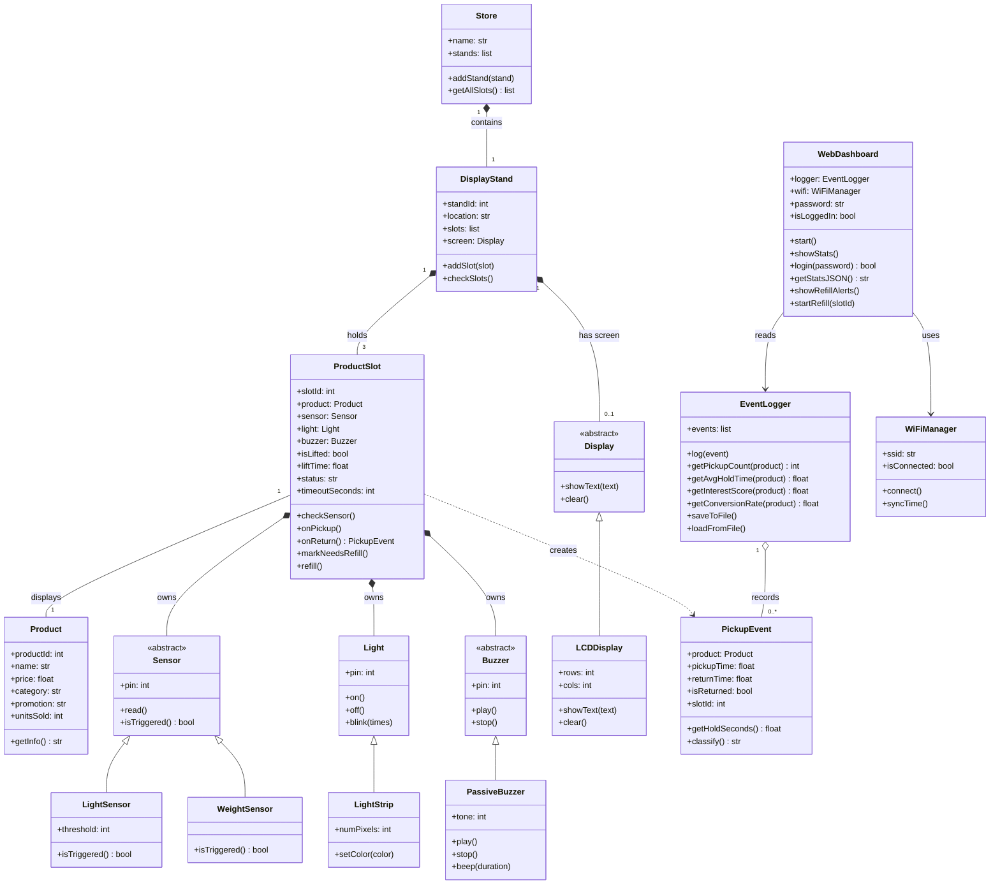
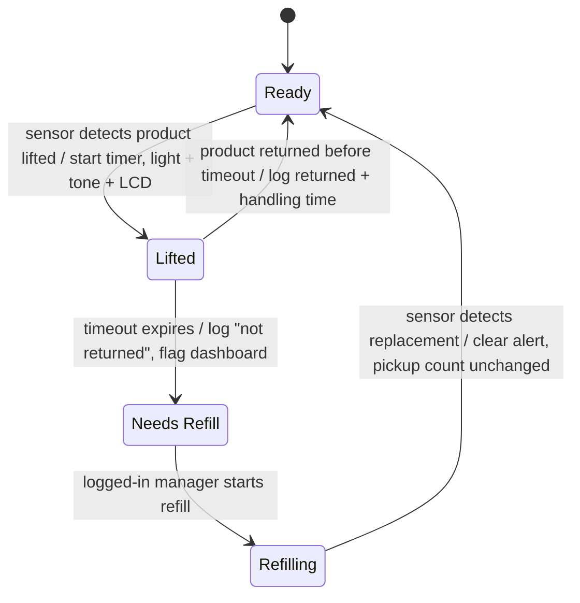

# Software Design - Pick Me Up (Group 4: Shelf Aware)

Author: Manuel Ramos (Programming Guru) - ISM 6106 Project Design Draft, November 2026

## Pickup and Return Behavior

The Pico runs one main loop about every 50 ms. On each pass, `DisplayStand.checkSlots()` calls `checkSensor()` on each of the three `ProductSlot`s. Each slot reads its `LightSensor` (GP26, GP27 or GP28) and compares the reading to the slot's calibrated threshold. A change only counts after it holds steady for about 300 ms, so a hand brushing past the slot is not logged as a pickup. Each slot keeps its own status, so all three work independently.

- **Pickup (Ready -> Lifted):** `onPickup()` sets `isLifted` and `liftTime`, turns on that slot's `Light`, plays a short tone on the `Buzzer`, and shows `Product.getInfo()` on the `LCDDisplay`.
- **Return (Lifted -> Ready):** if the product is back before `timeoutSeconds`, `onReturn()` creates a `PickupEvent` marked returned, with its handling time from `getHoldSeconds()`. The light turns off and the slot is ready again.
- **Timeout (Lifted -> Needs Refill):** if the slot is still empty after `timeoutSeconds`, the `PickupEvent` is marked "not returned" and `markNeedsRefill()` flags the slot on the dashboard. `timeoutSeconds` starts at 30 seconds for testing; the final value is set after observing shoppers.

The timeout check runs on every loop pass and the tone is stopped by the loop instead of a sleep, so one slot never freezes the other two or the dashboard.

## Event Logging and Statistics

Every pickup creates one `PickupEvent` (slotId, product, pickupTime, returnTime, isReturned, handling time). The `EventLogger` keeps events in memory and calls `saveToFile()` to append each one to flash, and `loadFromFile()` restores the history after a restart. A refill never deletes or changes an event and does not add to the pickup count.

Statistics per product: `getPickupCount()`, `getAvgHoldTime()` (returned products only), not-returned count, and `getInterestScore()`. Products are logged as "not returned", never as sold; sales comparison needs separate sales data and is optional.

## Manager Dashboard and Refill Process

`WiFiManager` connects the Pico to the store Wi-Fi and `WebDashboard` runs a small web server. Every request is checked with `isLoggedIn` first; requests that are not logged in are rejected and change nothing.

| Route | Does | Access |
| --- | --- | --- |
| `/` | `showStats()` and `showRefillAlerts()`: slot status, counts, average handling time, recent events | Logged-in manager |
| `/api/stats` | `getStatsJSON()`: same data as JSON; the page refreshes from it every few seconds | Logged-in manager |
| `/refill/<slotId>` | `startRefill(slotId)`: only accepted when the slot is in Needs Refill | Logged-in manager |

After `startRefill`, the slot moves to Refilling and ignores pickups. When the sensor reads a product steadily, `refill()` returns it to Ready. The original event and the pickup count are unchanged. Wi-Fi and dashboard passwords live in `secrets.py`, which is in `.gitignore`.

## Classes Implemented

DisplayStand, ProductSlot, Product, Sensor / LightSensor, Light, Buzzer / PassiveBuzzer, Display / LCDDisplay, PickupEvent, EventLogger, WebDashboard, WiFiManager.

Not implemented in the prototype (future features): Store (only one stand), WeightSensor, LightStrip, and `EventLogger.getConversionRate()` (needs sales data).

## Class Diagram (updated for the design draft)

## Product Slot State Diagram

